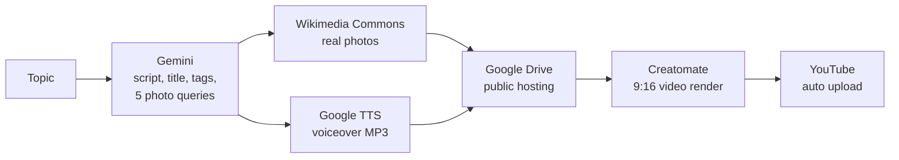

# YouTube Shorts Autonomous Production

An **n8n workflow** that creates and publishes a 30-second YouTube Short on any topic, **from idea to upload, with zero manual steps.**

**Demo topic:** *Top 3 must-visit places in Cox's Bazar, Bangladesh*
**Result:** ran end to end and published the video to YouTube.

## How it works

| Stage | What happens | Tool |
|---|---|---|
| 1. Content | Writes the title, 30s narration, description, 6 tags and 5 photo search queries (one per scene) | Google Gemini |
| 2. Visuals | Finds and downloads a real photo of each named place | Wikimedia Commons |
| 3. Voiceover | Converts the script to an MP3 | Google Text-to-Speech |
| 4. Hosting | Stores images and audio with public links for rendering | Google Drive |
| 5. Render | Builds a vertical video: 5 scenes x 6s, zoom effect, voiceover, on-screen title. Polls until ready | Creatomate |
| 6. Publish | Uploads the MP4 with the generated title, description and tags | YouTube Data API |

> **Why real photos?** AI image generators kept showing the wrong locations, so real photos of the actual places are used instead.

## Setup

1. Import `YouTube Shorts Autonomous Production.json` into n8n.
2. Create these credentials in n8n and attach them to the matching nodes:

| Credential | Used by |
|---|---|
| Google Gemini (PaLM) API key | Gemini Content Generator |
| HTTP Query Auth (`key` = Google Cloud API key, Text-to-Speech API enabled) | Google TTS node |
| Google Drive OAuth2 | 4 Drive nodes |
| Header Auth (`Authorization` = `Bearer <Creatomate key>`) | 2 Creatomate nodes |
| YouTube OAuth2 (YouTube Data API v3 enabled) | YouTube Upload node |

3. Open **Config: Niche & Template** and set your topic in `niche`.
   Set `youtubePrivacyStatus` to `private` while testing.
4. Click **Execute workflow**.

> **Never paste API keys directly into nodes.** They get exported with the workflow JSON. Always use n8n credentials.

## Limitations

Several paid tools could not be used because of API cost constraints. With a bigger budget the output would be better.

- Free render and image tiers limit video resolution (720x1280) and the number of test runs.
- YouTube's daily upload quota limits how many videos can be published per day.
- Paid plans would allow higher resolution, more natural voices and more reliable image sourcing.

## Tech stack

n8n, Google Gemini, Wikimedia Commons, Google Text-to-Speech, Google Drive, Creatomate, YouTube Data API
